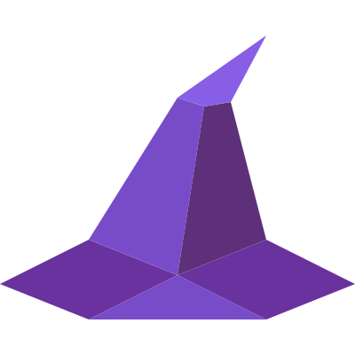

# WizardChat - Simple, Secure, Magical

[](https://gitlab.com/wizardchat/wizardchat-web/-/pipelines)
[](https://gitlab.com/wizardchat/wizardchat-web/-/releases)

[](https://matrix.to/#/#wizardchat-app:matrix.org)

WizardChat is a web-based Matrix client. End-to-end encrypted, open source, and works in your browser (and [your desktop](https://gitlab.com/wizardchat/wizardchat-desktop)).

## Features

- E2EE
- Direct messages and Spaces
- Voice and video calls (1:1 and group, via MatrixRTC / Element Call)
- File, image, and video sharing
- Pin messages
- Message search
- Threads
- Message reactions, edits, and replies
- Advanced Message formatting
- Typing indicators
- Custom Stickers and Emojis
- GIFs
- SSO login
- Read receipts
- Themes (Carbon, Parrot, Ethereal)

## Try out WizardChat

- **Stable**: [app.wizardchat.org](https://app.wizardchat.org)
- **Next** (pre-release): [next.wizardchat.org](https://next.wizardchat.org)

> WizardChat is also available as an Electron desktop app for Windows, macOS, and Linux. You can download it directly [here](https://wizardchat.org) or from the [GitLab releases page](https://gitlab.com/wizardchat/wizardchat-desktop/-/releases).

## Local Development

### Manual Setup

#### Prerequisites

- [Node.js](https://nodejs.org/) (v20 or higher)
- [npm](https://www.npmjs.com/)

1.  Clone the repository:

    ```bash
    git clone https://gitlab.com/wizardchat/wizardchat-web.git
    cd wizardchat-web
    ```

2.  Install dependencies and start development server:

    ```bash
    npm ci
    npm start
    ```

    The app will be available at **http://localhost:8080**

### Using Docker

- Just pull the newest docker image from [Gitlab Container Registry](https://gitlab.com/wizardchat/wizardchat-web/container_registry/)
