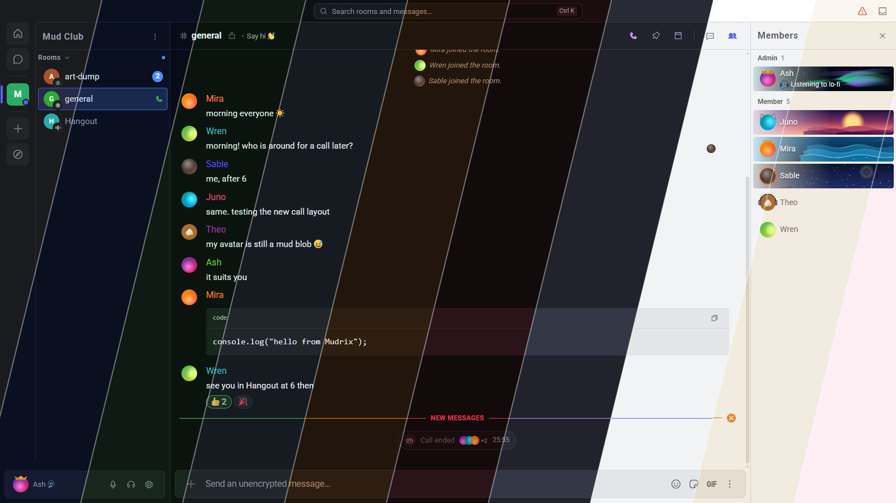

# Mudrix - Simple, Secure, Muddy

[](https://github.com/kapsikkum/mudrix-web/actions/workflows/check.yml)
[](https://github.com/kapsikkum/mudrix-web/releases)


Mudrix is a web-based Matrix client. End-to-end encrypted, open source, and works in your browser (and [your desktop](https://github.com/kapsikkum/mudrix-desktop)).

**Live:** https://kapsikkum.github.io/mudrix-web/ · **Desktop downloads:** [releases](https://github.com/kapsikkum/mudrix-desktop/releases/latest)

Mudrix is a fork of WizardChat (AGPL-3.0).



## Features

- E2EE
- Direct messages and Spaces
- Voice and video calls (1:1 and group, via MatrixRTC / Element Call)
- File, image, and video sharing
- Pin messages
- In-room message search (server-side full history in unencrypted rooms; already-loaded messages only in encrypted rooms)
- Jump to date, edit history viewer, mark room as unread, low-priority rooms
- Threads
- Message reactions, edits, and replies
- Advanced Message formatting
- Typing indicators
- Custom Stickers and Emojis
- GIFs (GIPHY and KLIPY search, favourite GIFs straight from a message, even in encrypted rooms)
- Sticker packs: click a sticker to see the public pack it came from
- Rich profiles: verification status, sessions, private notes, activity, a "Mudrix user" badge, avatar decorations and effects
- 11 languages (English, Deutsch, Español, Français, Italiano, Português, Русский, 日本語, Türkçe, Nederlands, Polski)
- SSO login
- Read receipts
- Themes (Carbon, Parrot, Hallow, Ethereal)

## Try out Mudrix

Open the hosted client at **https://kapsikkum.github.io/mudrix-web/**, install the [desktop app](https://github.com/kapsikkum/mudrix-desktop/releases/latest), or run it locally (see [Local Development](#local-development) below).

The hosted client is deployed by `.github/workflows/pages.yml` whenever a `v*` tag is pushed. It builds with `BASE_PATH=/mudrix-web/`, so the app, router, service worker and SSO/OIDC callbacks all work under that subpath, and `index.html` is copied to `404.html` so deep links resolve. To host it under a subpath of your own, build with `BASE_PATH=/your/path/ npx vite build`.

## Desktop app

Mudrix has a desktop app (Tauri v2, tray, notifications, unread badge, deep links, themed app icon, and in-app updates: Windows and macOS download and install new releases from the repository's release feed, Linux shows a download prompt) in the separate [mudrix-desktop](https://github.com/kapsikkum/mudrix-desktop) repository, which includes this repository as a git submodule. The desktop-specific code on this side is `src/util/desktop.ts` (a no-op in a browser), the "Desktop app" section in Settings > Preferences (shown only inside the desktop app) and the unread/notification hooks. The Tauri API is imported dynamically, so the web build is unaffected.

CI: `.github/workflows/check.yml` (typecheck, lint, build), `release.yml` (tag `v*`: `mudrix-web-<version>.zip` plus an optional Docker image on GHCR) and `pages.yml` (tag `v*`: GitHub Pages deploy). `.gitlab-ci.yml` is upstream WizardChat's pipeline and is not used here.

## Local Development

### Manual Setup

#### Prerequisites

- [Node.js](https://nodejs.org/) (v20 or higher)
- [npm](https://www.npmjs.com/)

1.  Clone the repository:

    ```bash
    git clone https://github.com/kapsikkum/mudrix-web.git
    cd mudrix-web
    ```

2.  Install dependencies and start development server:

    ```bash
    npm ci
    npm start
    ```

    The app will be available at **http://localhost:8080**

#### Optional: GIF search (GIPHY / KLIPY)

The GIF picker calls GIPHY and KLIPY directly from the client. API keys are supplied at **build time** via a git-ignored `.env.local` (see `.env.example`):

```bash
VITE_GIPHY_API_KEY=your_giphy_key
VITE_KLIPY_API_KEY=your_klipy_key
```

Restart `npm start` after changing them. A provider without a key has its tab disabled ("No API key configured in this build").

In CI the keys come from the repository secrets `VITE_GIPHY_API_KEY` and `VITE_KLIPY_API_KEY`, used by the release, Pages and Docker builds.

Note: `VITE_` values are embedded in the built bundle, so the keys are visible to anyone who can load the app. KLIPY keys are tied to your KLIPY account, and a GIPHY key should be your own (create one at developers.giphy.com).

### Using Docker

- Just pull the newest docker image from the GHCR image published by `release.yml` on `v*` tags (GitHub Container Registry)

- GIF keys are build-time values: pass `--build-arg VITE_GIPHY_API_KEY=... --build-arg VITE_KLIPY_API_KEY=...` to the image build (they end up in the bundle).
